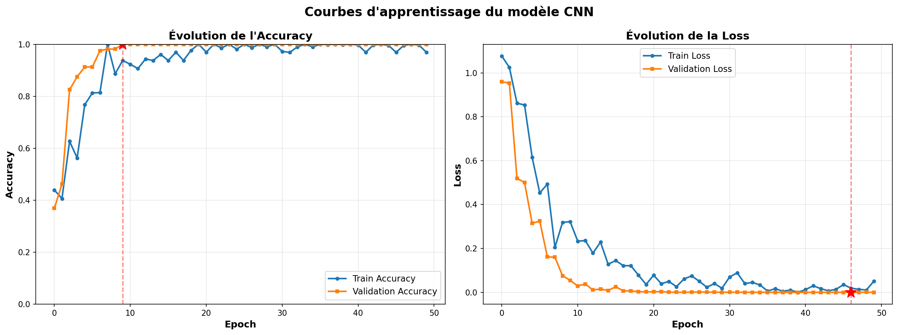
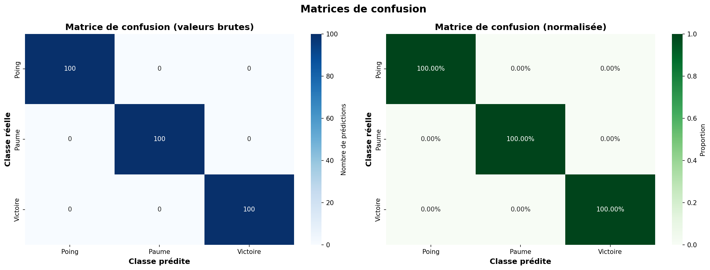

# Hand Gesture Recognition

A real-time hand gesture recognition system built with Python, TensorFlow, Keras, and OpenCV. The project implements an end-to-end computer vision pipeline, from synthetic dataset generation and CNN training to webcam-based inference.

The model classifies three static hand gestures: **closed fist**, **open palm**, and **victory sign**. The application integrates HSV-based hand detection, image preprocessing, CNN inference, and temporal prediction smoothing to provide live predictions.

<p align="left">
  
  
  
  
  
</p>

---

## Overview

The goal of this project is to explore how deep learning and computer vision can enable gesture-based human-computer interaction.

The implementation covers the main stages of a machine learning workflow:

- Synthetic dataset generation and exploratory data analysis.
- Image preprocessing and normalization with OpenCV.
- CNN architecture design and model training with TensorFlow and Keras.
- Model evaluation using classification metrics and a confusion matrix.
- Real-time webcam inference through a modular Python application.

The project focuses on **static gesture classification**, where each input image represents a single gesture. Dynamic gesture recognition involving movement over time is considered a potential extension.

## Key Features

- Classification of three hand gestures: closed fist, open palm, and victory sign.
- Synthetic image dataset generation with configurable variations and noise.
- Image preprocessing using grayscale conversion, CLAHE, Gaussian blur, and normalization.
- CNN training with data augmentation and training callbacks.
- Model evaluation using accuracy, precision, recall, F1-score, and AUC.
- Real-time webcam processing using OpenCV.
- Temporal prediction smoothing to reduce unstable class changes.
- Modular application code separating detection, preprocessing, prediction, and visualization.

## System Pipeline

The project follows two connected workflows: model development and real-time inference.

```text
MODEL DEVELOPMENT

Synthetic Data Generation
          |
          v
Exploratory Data Analysis
          |
          v
Image Preprocessing
          |
          v
CNN Architecture and Training
          |
          v
Model Evaluation


REAL-TIME INFERENCE

Webcam Input
     |
     v
HSV-Based Hand Detection
     |
     v
Region of Interest Extraction
     |
     v
Image Preprocessing
     |
     v
CNN Prediction
     |
     v
Temporal Smoothing
     |
     v
Predicted Gesture and Confidence
```

The numbered notebooks document the model development workflow. The real-time application is implemented separately in `src/` and launched through `app.py`.

## Dataset

### Synthetic Dataset

The primary dataset is generated programmatically by `notebooks/01_generate_data.ipynb`.

Each image is a 28 × 28 grayscale representation of a simplified geometric shape corresponding to one of the three gesture classes:

| Label | Gesture | Synthetic representation |
|---|---|---|
| 0 | Closed fist | Circle |
| 1 | Open palm | Rectangle |
| 2 | Victory sign | V-shaped form |

Random variations in position, size, and background noise introduce variability into the generated images.

The dataset follows a CSV layout compatible with the pixel-column format used by Sign Language MNIST.

| Split | Images | Distribution |
|---|---:|---|
| Training | 720 | 240 per class |
| Validation | 180 | 60 per class |
| Test | 300 | 100 per class |
| **Total** | **1,200** | **400 per class** |

The dataset is generated locally and is not versioned in the repository. Run the data generation notebook to recreate it.

### Preliminary Experiments

The `notebooks/experiments/` directory contains preliminary experiments using [Sign Language MNIST](https://www.kaggle.com/datasets/datamunge/sign-language-mnist).

Because that dataset focuses on sign-language alphabet letters rather than the three gestures targeted by this project, the implementation subsequently moved to a dedicated synthetic dataset.

## Image Preprocessing

The training and inference pipelines use consistent preprocessing steps.

1. **Grayscale conversion:** Convert images to a single-channel representation.
2. **Resizing:** Resize images to 28 × 28 pixels using OpenCV's `INTER_AREA` interpolation.
3. **Contrast enhancement:** Apply CLAHE with a clip limit of 2.0 and a 4 × 4 tile grid.
4. **Noise reduction:** Apply a 3 × 3 Gaussian blur.
5. **Normalization:** Scale pixel values to the range [0, 1].
6. **Reshaping:** Prepare the input tensor with the shape `(28, 28, 1)`.

The preprocessing implementation is available in `src/preprocessing/image_processing.py`.

## CNN Architecture

The classifier is a sequential convolutional neural network designed for lightweight image classification.

| Layer | Configuration | Output shape |
|---|---|---|
| Input | Grayscale image | 28 × 28 × 1 |
| Conv2D + MaxPooling2D | 32 filters, 3 × 3 kernel, ReLU, 2 × 2 pooling | 14 × 14 × 32 |
| Conv2D + MaxPooling2D | 64 filters, 3 × 3 kernel, ReLU, 2 × 2 pooling | 7 × 7 × 64 |
| Conv2D | 64 filters, 3 × 3 kernel, ReLU | 7 × 7 × 64 |
| Flatten | Flatten feature maps | 3,136 |
| Dense | 64 units, ReLU | 64 |
| Dropout | Rate: 0.5 | 64 |
| Output | 3 units, Softmax | 3 |

The architecture contains approximately **256,707 trainable parameters**, according to the project configuration.

The model architecture is exported to `models/model_architecture.json`.

## Training Configuration

The model is trained using TensorFlow and Keras with the following configuration.

| Parameter | Value |
|---|---|
| Optimizer | Adam |
| Learning rate | 0.001 |
| Loss function | Sparse categorical cross-entropy |
| Batch size | 32 |
| Maximum epochs | 50 |
| Early stopping | Patience of 10 epochs |
| Learning rate scheduling | ReduceLROnPlateau, factor 0.5, patience 5 |
| Checkpointing | ModelCheckpoint |

### Data Augmentation

Training images are augmented dynamically using:

- Random rotations up to approximately ±15 degrees.
- Horizontal and vertical translations up to 10%.
- Shear transformations.
- Zoom variations up to 10%.

Horizontal flipping is disabled.

These transformations are applied to the training data only. The reported implementation was trained on CPU using TensorFlow 2.20 and Keras 3.10.

## Evaluation Results

The model was evaluated on a test set of 300 synthetic images.

| Metric | Reported result |
|---|---:|
| Accuracy | 100% |
| Precision, recall, and F1-score | 1.00 per class |
| AUC | 1.00 per class |
| Best validation epoch | 10 |

### Learning Curves

<p align="center">
  
</p>

### Confusion Matrix

<p align="center">
  
</p>

### Interpreting the Results

The reported metrics demonstrate that the model can distinguish the three synthetic shape classes in the evaluated dataset.

**These results do not establish 100% accuracy on real hand gestures.** The training and test images are generated using the same synthetic data-generation approach, and the model has not been validated on a representative dataset of real hands.

Real-world performance remains dependent on the visual differences between synthetic and real images, as well as the quality of webcam hand detection, lighting, and background conditions.

## Real-Time Webcam Application

The application is launched through `app.py`, with the underlying implementation organized into modules under `src/`.

### Inference Workflow

1. **Hand detection:** Segment skin-colored regions in HSV color space, apply morphological operations, and extract contours.
2. **Region of interest extraction:** Select the largest contour that exceeds the configured minimum area and extract a square crop around it.
3. **Preprocessing:** Apply the same image-processing pipeline used during training.
4. **Classification:** Pass the processed image to the trained CNN.
5. **Temporal smoothing:** Average class probabilities over the five most recent frames to reduce prediction fluctuations.
6. **Visualization:** Display the detected region, predicted gesture, confidence, and class probabilities.

### Application Modules

| Module | Responsibility |
|---|---|
| `src/detection/hand_detector.py` | HSV-based skin segmentation and contour selection |
| `src/preprocessing/image_processing.py` | Region of interest extraction and image preprocessing |
| `src/model/model_loader.py` | Loading the trained Keras model |
| `src/model/predictor.py` | Gesture prediction and temporal smoothing |
| `src/utils/visualization.py` | Drawing predictions and annotations |
| `src/utils/config.py` | Centralized configuration |
| `src/app/realtime_app.py` | Webcam processing loop and application control |

## Project Structure

```text
Hand-Gesture-Recognition/
├── app.py
├── requirements.txt
├── models/
│   ├── model_architecture.json
│   └── model_metadata.json
├── notebooks/
│   ├── 00_setup_project.ipynb
│   ├── 01_generate_data.ipynb
│   ├── 02_data_exploration.ipynb
│   ├── 03_preprocessing.ipynb
│   ├── 04_build_model.ipynb
│   ├── 05_train_model.ipynb
│   ├── 06_evaluate_model.ipynb
│   ├── 07_realtime_inference.ipynb
│   └── experiments/
├── results/
│   └── plots/
└── src/
    ├── app/
    ├── detection/
    ├── model/
    ├── preprocessing/
    └── utils/
```

Generated datasets and trained model weights are excluded from version control. Run the relevant notebooks to regenerate the required artifacts.

## Installation

### Prerequisites

- Python 3.9 or a compatible version supported by the installed dependencies.
- A working webcam for real-time inference.
- Git.
- A Python environment capable of installing the packages listed in `requirements.txt`.

### 1. Clone the Repository

```bash
git clone https://github.com/ELGHAD/Hand-Gesture-Recognition.git
cd Hand-Gesture-Recognition
```

### 2. Create a Virtual Environment

**Windows:**

```bash
python -m venv venv
venv\Scripts\activate
```

**Linux / macOS:**

```bash
python3 -m venv venv
source venv/bin/activate
```

### 3. Install Dependencies

```bash
python -m pip install --upgrade pip
pip install -r requirements.txt
```

## Usage

### Step 1: Generate the Dataset and Train the Model

The trained model weights are not included in the repository. Run the notebooks in the following order to reproduce the pipeline.

```bash
jupyter notebook notebooks/
```

| Order | Notebook | Purpose |
|---|---|---|
| 1 | `00_setup_project.ipynb` | Initialize project directories |
| 2 | `01_generate_data.ipynb` | Generate synthetic training and test datasets |
| 3 | `02_data_exploration.ipynb` | Explore dataset distributions and samples |
| 4 | `03_preprocessing.ipynb` | Prepare model inputs |
| 5 | `04_build_model.ipynb` | Define the CNN architecture |
| 6 | `05_train_model.ipynb` | Train and save the model |
| 7 | `06_evaluate_model.ipynb` | Evaluate performance and generate plots |

The real-time inference notebook is provided as a prototype of the webcam workflow. The standalone application can be launched separately after the required model artifacts have been generated.

### Step 2: Launch Real-Time Inference

```bash
python app.py
```

Ensure your webcam is connected and accessible. Position your hand against a relatively uniform background with consistent lighting.

| Key | Action |
|---|---|
| `q` | Quit the application |
| `s` | Save a screenshot to `results/plots/` |

The application uses the configured webcam index, which defaults to `0`.

## Configuration

The main application parameters are centralized in `src/utils/config.py`.

| Parameter | Default value | Description |
|---|---:|---|
| `WEBCAM_INDEX` | 0 | Camera device index |
| `MIN_DETECTION_AREA` | 5000 | Minimum contour area for hand detection |
| `HAND_MARGIN` | 20 | Padding around the detected hand |
| `PREDICTION_HISTORY_SIZE` | 5 | Number of frames used for smoothing |
| `CLAHE_CLIP_LIMIT` | 2.0 | CLAHE contrast limit |

HSV skin-detection thresholds are defined in `src/detection/hand_detector.py`. Depending on the camera, lighting, skin tone, and background, these thresholds may need adjustment.

## Limitations and Future Improvements

### Current Limitations

- **Synthetic training data:** The classifier has not been validated on a representative real-world hand gesture dataset.
- **HSV-based detection:** Skin-color segmentation can be sensitive to lighting, background colors, and variations in skin tone.
- **Static gesture classification:** The model classifies individual images rather than interpreting complete motion sequences.
- **Limited gesture vocabulary:** Only three gesture classes are supported.
- **Environmental sensitivity:** Webcam quality, hand positioning, and background conditions can affect detection and prediction.

### Potential Improvements

1. Collect and annotate real hand images to evaluate generalization under realistic conditions.
2. Replace HSV-based segmentation with hand landmark detection using [MediaPipe](https://ai.google.dev/edge/mediapipe/solutions/vision/hand_landmarker).
3. Introduce temporal modeling, such as CNN-LSTM architectures, to recognize dynamic gestures.
4. Expand the dataset to support additional hand gestures and use cases.
5. Explore TensorFlow Lite for deployment on mobile and resource-constrained devices.
6. Add automated tests and benchmarking across different environments.

## Author

**Hamza Elrhadiouini (ELGHAD)**

- GitHub: [@ELGHAD](https://github.com/ELGHAD)
- Repository: [Hand-Gesture-Recognition](https://github.com/ELGHAD/Hand-Gesture-Recognition)

## License

This project is distributed under the MIT License. See the [`LICENSE`](LICENSE) file for details.
